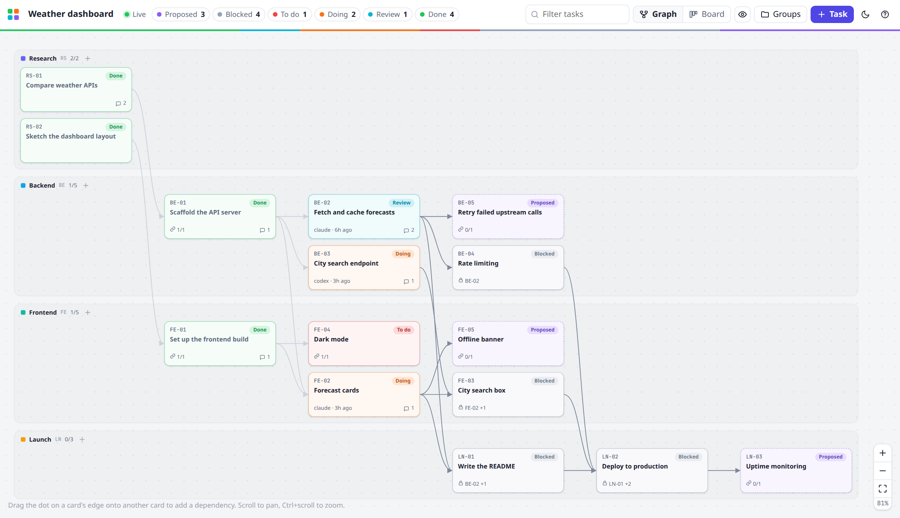
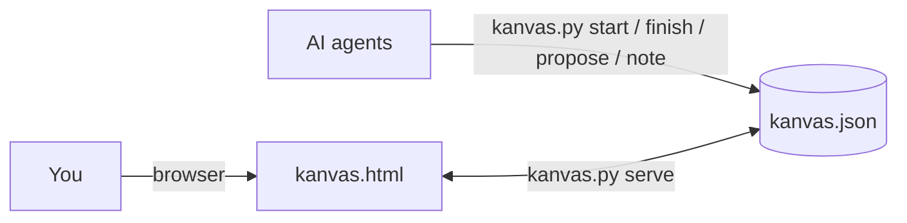
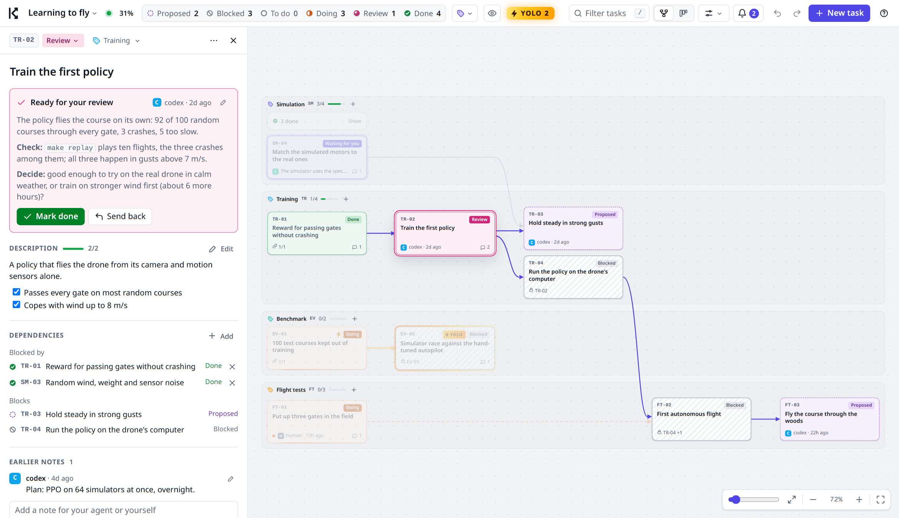
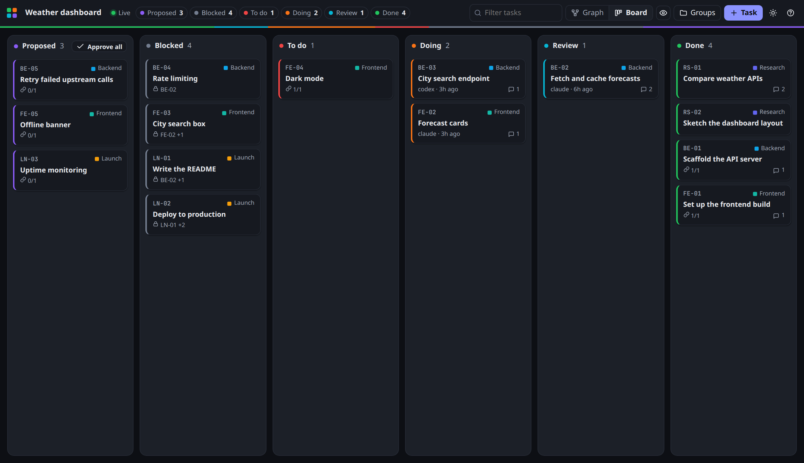

# Kanvas

A task board you share with your AI coding agents. Agents plan and report through a small CLI; you approve, steer and review in an interactive board in your browser.

One JSON file, one Python script, one HTML page. No accounts, no build step, no dependencies.



## Why

AI agents do their best work in a terminal, but a project needs a plan that outlives a single chat: what is left, what depends on what, what was decided and why. Kanvas keeps that plan in `kanvas.json` next to your code, where you and any number of agents work on it together.

- **You stay in control.** Agents propose tasks and you approve them. Agents finish tasks and you review them. Only you mark work done, unless you hand a chain of tasks over with YOLO.
- **Agents cannot break the board.** They change it through `kanvas.py`, which enforces the workflow and rejects invalid moves with a clear message.
- **Live.** Agent changes appear in the browser within a second, and your edits are on disk immediately for the agent's next command.
- **Agent-agnostic.** Claude Code, Codex, Cursor, Gemini CLI, or anything that runs shell commands. Use several at once; notes record who did what.
- **Git-friendly.** The board is plain, stably formatted JSON. Commit it with the code and your history shows how the plan evolved.

## Quick start

Requirements: Python 3.8+ and a browser. Works on Linux, macOS and Windows.

```bash
git clone https://github.com/XMihura/Kanvas.git ~/Kanvas
cd ~/code/my-project
python ~/Kanvas/kanvas.py init
python .agents/skills/kanvas/kanvas.py serve
```

`init` creates `kanvas.json` and installs the agent skill in `.agents/skills/kanvas/`, with copies of `SKILL.md` in `.claude/skills/` (and in `.cursor/` or `.gemini/` when those folders exist). It never modifies an existing file. Agents that support skills pick it up automatically; for any other agent, add this line to `AGENTS.md` or `CLAUDE.md`:

```
Plan and track work on the Kanvas board; follow .agents/skills/kanvas/SKILL.md.
```

Then ask your agent:

> Interview me about this project and plan it on the Kanvas board.

The plan arrives as proposals. Approve the ones you want, and tell the agent to start working.

## How it works



Every task moves through five states. A to-do task whose dependencies are unfinished shows as blocked, and becomes ready by itself once they are done.

| State | Color | Who moves it there |
|-------|-------|--------------------|
| Proposed | purple | An agent proposes it |
| To do | red (gray while blocked) | You approve it |
| Doing | orange | An agent starts it |
| Review | cyan | The agent finishes it, with a summary of what it did |
| Done | green | You accept it, or send it back with feedback |

Agents may propose tasks and groups, start ready tasks, finish or pause tasks in progress, add notes and add dependencies. Everything else belongs to you: approving, editing, deleting, marking done. Feedback you leave when sending a task back becomes a note the agent reads when it picks the task up again.

## The board



- **Graph view.** One swimlane per group, laid out by dependency depth, flowing left to right or top to bottom (press `L` to switch). The slider under the zoom buttons, or `[` and `]`, compresses or extends the space between dependency levels. Hover or select a task to highlight everything it depends on and everything waiting for it. Each card has a dot on its incoming and outgoing side: drag one onto another card to add a dependency in that direction (cycles are refused). Click an arrow to open or remove the dependency.
- **Board view.** Kanban columns by state. Drag cards between columns, or approve every proposal at once.
- **Task panel.** Title, Markdown description, state, group, dependencies and the notes timeline. Approve, start, send to review, mark done, or send back with feedback.
- **Right-click menus.** On a card: state actions, a new task that depends on it, adding and removing dependencies, copying the ID, deleting. On an arrow (left or right click): the two tasks it connects are highlighted and shown in the menu; click either one to open it, or remove the connection. On empty space: a new task in that group, or a new group.
- **Undo and redo.** Ctrl+Z undoes your last change in the browser, Ctrl+Shift+Z or Ctrl+Y redoes it, and the arrows next to the filter box do the same. Changes agents made in the meantime are kept: an undo only touches what your change touched, and refuses if an agent has changed that since. Inside a text field, Ctrl+Z undoes typing as usual.
- **YOLO.** "YOLO up to here…" on a card (right-click menu or task panel) hands that task and everything it depends on to the agents: they may start the chain's proposals without approval, and finishing a task marks it done without review. Turning it on approves the chain's current proposals and marks the tasks waiting for review as done. The task carries a YOLO tag and the tasks it covers a lightning icon; the same menu turns it off.
- **Everything else.** Filter by state, search, hide finished work, groups with their own ID prefixes, dark mode, keyboard shortcuts (press `?`), and links: `#BE-02` in the URL opens that task.



There are three ways to open it:

| | |
|---|---|
| `kanvas.py serve` | Any browser, live two-way sync. Concurrent changes from agents and the browser merge automatically. |
| Open `kanvas.html` directly | In Chrome or Edge, choose your `kanvas.json` and the page reads and writes it in place, with live updates. Other browsers edit a copy in the tab; **Save** downloads it. |
| `kanvas.py export` | A single self-contained, read-only HTML snapshot to share or attach to a pull request. |

## CLI

Agents use these commands; you can too. Run `python kanvas.py -h` for details.

| Command | Purpose |
|---------|---------|
| `status` | Overview: doing, waiting for review, ready, blocked, proposed, problems |
| `ready` / `blocked` | What can start now / what waits on what |
| `show ID` | Details, dependencies and notes |
| `list [STATE or GROUP]` | Tasks by group, optionally filtered |
| `start ID [-m NOTE]` | To do to doing; proposals under YOLO too |
| `finish ID -m SUMMARY` | Doing to review, or to done under YOLO; the summary is required and kept as a note |
| `pause ID [-m NOTE]` | Doing back to to do |
| `note ID TEXT` | Append a note; descriptions stay as the human wrote them |
| `propose GROUP TITLE [DESC] [--deps ID ...]` | Propose a task |
| `add-group NAME [--prefix XX]` | Create a group |
| `batch` | Propose many groups and tasks from JSON on stdin |
| `depend ID ON [ON ...]` | Add dependencies |
| `check` | Validate the board; exit code 1 on errors |
| `serve [--port N] [--host H]` | Open the board in the browser |
| `init [DIR]` | Set up Kanvas in a project |
| `import FILE.canvas` | Migrate a Kanvas 0.x Obsidian board |
| `export [FILE.html]` | Write a read-only snapshot |

Text arguments also accept `--stdin` and `--file PATH`, read as UTF-8 on every platform, which is the reliable way to pass multi-line or non-ASCII text from any shell. Notes are signed with `--as NAME` or the `KANVAS_AGENT` environment variable. The CLI finds `kanvas.json` in the current directory or any parent; `--board PATH` or `KANVAS_BOARD` point elsewhere.

Writes take a short lock and replace the file atomically, so several agents and the browser can work at the same time without losing changes.

## File format

```json
{
  "kanvas": 1,
  "title": "Weather dashboard",
  "groups": [
    {
      "id": "BE",
      "name": "Backend"
    }
  ],
  "tasks": [
    {
      "id": "BE-02",
      "title": "Fetch and cache forecasts",
      "state": "review",
      "group": "BE",
      "deps": ["BE-01"],
      "desc": "`GET /forecast` proxies Open-Meteo.",
      "notes": [
        {
          "at": "2026-10-19T11:05:00Z",
          "by": "claude",
          "text": "Done: responses cached for 10 minutes; 23 tests pass."
        }
      ]
    }
  ]
}
```

States are `proposed`, `todo`, `doing`, `review` and `done`; blocked is computed. `"yolo": true` on a task puts it and everything it depends on under YOLO. The CLI and the browser write the same canonical formatting, so diffs show only real changes. Unknown fields are preserved. See [`examples/sample.json`](examples/sample.json) for a complete board.

## Migrating from Kanvas 0.x (Obsidian)

```bash
python ~/Kanvas/kanvas.py init
python .agents/skills/kanvas/kanvas.py import Project.canvas
```

Card colors become states, groups come from the canvas groups, arrows become dependencies, and existing task IDs are kept. The `.canvas` file is left untouched. Once you are happy with the result, delete `Project.canvas`, `canvas-tool.py`, `RULES.md`, the Kanvas instructions in `CLAUDE.md` / `AGENTS.md`, and the `.obsidian/plugins/canvas-watcher` plugin.

## Development

```bash
python -m unittest discover -s tests -v
```

The suite is standard library only; one test also runs the browser's serializer under Node.js when it is installed, to check that both sides write identical files. Contributor notes are in [AGENTS.md](AGENTS.md).

## License

MIT
